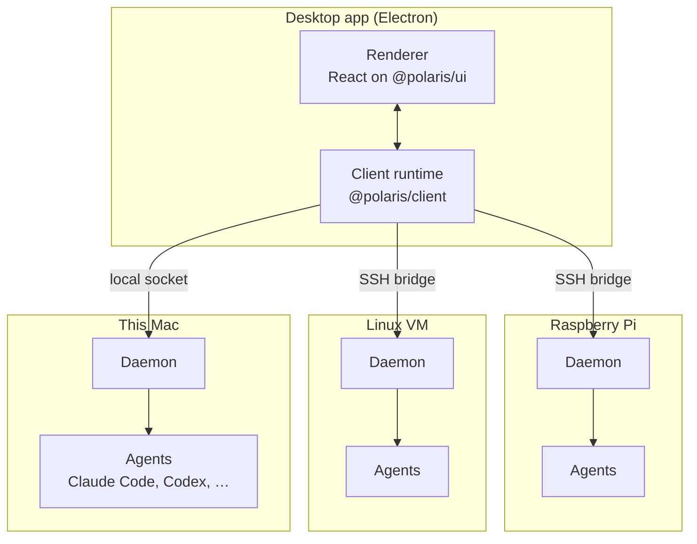

<a href="https://polaris.lux.dev">
  <picture>
    <source media="(prefers-color-scheme: light)" srcset="docs/assets/readme/hero-light.webp">
    
  </picture>
</a>

<p align="center">
  <a href="https://github.com/luxdotdev/polaris/actions/workflows/ci.yml"></a>
  <a href="LICENSE"></a>
  
</p>

<p align="center">
  <a href="https://polaris.lux.dev">Website</a>
  ·
  <a href="https://github.com/luxdotdev/polaris/releases">Download</a>
  ·
  <a href="docs/adr">Decisions</a>
  ·
  <a href="CONTEXT.md">Glossary</a>
  ·
  <a href="DESIGN.md">Design</a>
  ·
  <a href="CONTRIBUTING.md">Contributing</a>
</p>

> [!NOTE]
> Polaris is early and changing fast. It runs on Macs with Apple silicon. A Windows build is available as an experiment: it's unsigned, and it connects only to remote machines.

## About

You already have coding agents. Polaris is where you run them all and see what each one is doing.

It drives the agents you use today, such as Claude Code and Codex, instead of replacing them. Run them side by side on your Mac, a Linux VM, a Raspberry Pi, or any machine you can reach over SSH, all from one window. Polaris tells you which agent needs you, and when you review its work, it puts the riskiest changes first. Then you can read and edit the code yourself in the same app.

Close the app, lose your connection or restart a machine: your agent sessions are still there when you come back.

## Features

- **Run agents side by side.** Start, watch and steer [Claude Code, Codex, OpenCode, Gemini CLI and GitHub Copilot CLI](packages/protocol/src/harnesses.ts) across machines and projects. Every session shows whether it's working, done or stuck. Approvals and questions land in one "needs you" inbox, with notifications and a count in the menu bar. Polaris never signs in to an agent for you or touches its credentials ([ADR 0001](docs/adr/0001-polaris-never-touches-provider-credentials.md)).
- **Use any machine.** Your Mac, a Linux VM, a Raspberry Pi. Polaris sets itself up over the SSH config you already have, and asks before it installs anything. On Windows, WSL 2 distros can be hosts too (experimental).
- **Split big jobs.** A lead agent breaks work into a graph of tasks and hands each to its own agent. You see what's blocked, what's ready for review and what's waiting on you.
- **Review with the risk up front.** Check a pull request, or what an agent just did, in a separate checkout, so your own working copy stays untouched. A risk summary from rules, a secret scanner and a reviewer agent of your choice ranks what to look at first, and you mark each finding as you go.
- **Edit the code.** A full editor with language servers for TypeScript, Python, Go, Rust, Java, PHP, Lua, SQL, Svelte and more, on any machine. Follow along as an agent edits a file, or ask for an inline change.
- **Tab completion, on your hardware.** Suggestions as you type, from a model server you run yourself: llama-server, LM Studio, Ollama or any OpenAI-compatible endpoint. Nothing leaves your machines.
- **Real terminals.** On every machine, plus the agent's own terminal UI when you want to take a session over and hand it back.

<picture>
  <source media="(prefers-color-scheme: light)" srcset="docs/assets/readme/constellation-light.webp">
  
</picture>
<p align="center"><sub>A lead agent and its tasks</sub></p>

<picture>
  <source media="(prefers-color-scheme: light)" srcset="docs/assets/readme/review-light.webp">
  
</picture>
<p align="center"><sub>Review, with the riskiest change first</sub></p>

<sub>Screenshots use sample data.</sub>

## Install

**Download.** Get the Mac app (Apple silicon) from [polaris.lux.dev](https://polaris.lux.dev) or the [latest release](https://github.com/luxdotdev/polaris/releases). It updates itself, and it brings along everything it installs on your other machines. You'll also need at least one agent, like Claude Code or Codex, installed wherever you want agents to run.

**Build from source.** You need [Bun](https://bun.sh) 1.3.9 or later, and git.

```sh
git clone https://github.com/luxdotdev/polaris.git
cd polaris
bun install
bun run --cwd apps/desktop dev
```

In development, the app uses the daemon already running on your Mac if there is one. Otherwise it starts its own, with a scripted test agent that spends no tokens ([ADR 0007](docs/adr/0007-the-desktop-dev-daemon-is-its-own.md)). Packaging and releases are covered in [`apps/desktop/README.md`](apps/desktop/README.md).

## How it works



- A **host** is any machine where your code lives and agents run. Each host runs a small background service, the **daemon** (`polaris`, a single compiled Bun binary). It owns that machine's agent sessions, files, git, terminals and language servers.
- The **desktop app** talks to many daemons at once: the one on your Mac over a local socket, and the others through `ssh <host> polaris bridge`. If a connection drops, it picks up from the last thing it saw.
- Everything that happens is recorded as an event in the daemon's log, and the app's view is rebuilt from that log. After a crash or restart, an agent never carries on with a half-finished turn by itself ([ADR 0004](docs/adr/0004-restart-recovery-never-continues-a-turn.md)).
- The protocol between them lives in [`packages/protocol`](packages/protocol). The trickiest parts (the event store, streaming, recovery, approvals and reconnecting) are specified in Quint in [`packages/spec`](packages/spec) and tested against the real code.

Every term is defined in [`CONTEXT.md`](CONTEXT.md), and the decisions behind the design are in [`docs/adr`](docs/adr).

## Repository layout

| Path | What |
|---|---|
| [`apps/daemon`](apps/daemon) | The daemon: event store, agent drivers, transport, files, git, terminals, language tooling. |
| [`apps/desktop`](apps/desktop) | The Electron desktop app: the client runtime in the main process, a typed IPC bridge and a React renderer. |
| [`apps/site`](apps/site) | [polaris.lux.dev](https://polaris.lux.dev), with the download and update feed routes. |
| [`packages/protocol`](packages/protocol) | The protocol the app and every daemon share. |
| [`packages/client`](packages/client) | Connecting to many daemons over SSH: connection states, resuming, installing and upgrading. |
| [`packages/ui`](packages/ui) | The design system in code: DESIGN.md's tokens, components and a gallery. |
| [`packages/predict`](packages/predict) | The fill-in-the-middle predictor behind tab completion. |
| [`packages/spec`](packages/spec) | The Quint specification and its checks. |
| [`packages/bench`](packages/bench) | Benchmarks: the real daemon under scripted load, with per-machine baselines. |
| [`packages/lint-config`](packages/lint-config) | Shared oxlint and oxfmt config and custom rules. |
| [`tooling`](tooling) | The lint ratchet, the quality runner and the git hooks. |
| [`design`](design) | Brand assets and the scripts that generate them. |

Product and design truth live in [`PRODUCT.md`](PRODUCT.md) and [`DESIGN.md`](DESIGN.md).

## Contributing

Issues and pull requests are welcome. [`CONTRIBUTING.md`](CONTRIBUTING.md) covers setup, the git hooks, linting, tests, the spec and the rules for borrowed code. Everyone taking part follows the [Code of Conduct](CODE_OF_CONDUCT.md).

## Security

Found a vulnerability? Please don't open a public issue. Report it privately through [GitHub](https://github.com/luxdotdev/polaris/security/advisories/new) or to [security@lux.dev](mailto:security@lux.dev); [`SECURITY.md`](SECURITY.md) has the details.

## Licence

Polaris is licensed under the [Apache License 2.0](LICENSE), © 2026 lux.dev LLC. Some assets are under their own licences (the Nucleo icons and the Geist Pixel font); see [`NOTICE`](NOTICE). Code adapted from other projects is listed in [`ATTRIBUTION.md`](ATTRIBUTION.md), and dependencies in [`THIRD_PARTY_NOTICES.md`](THIRD_PARTY_NOTICES.md).
