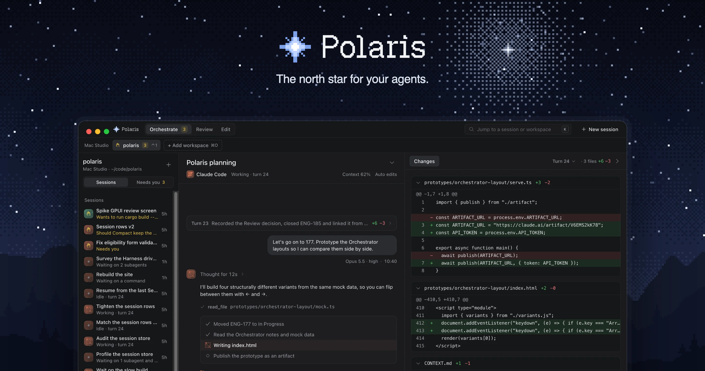
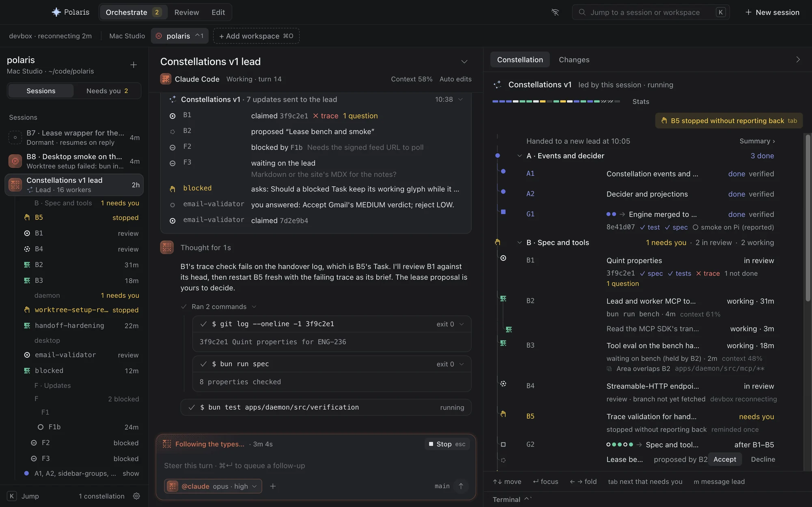
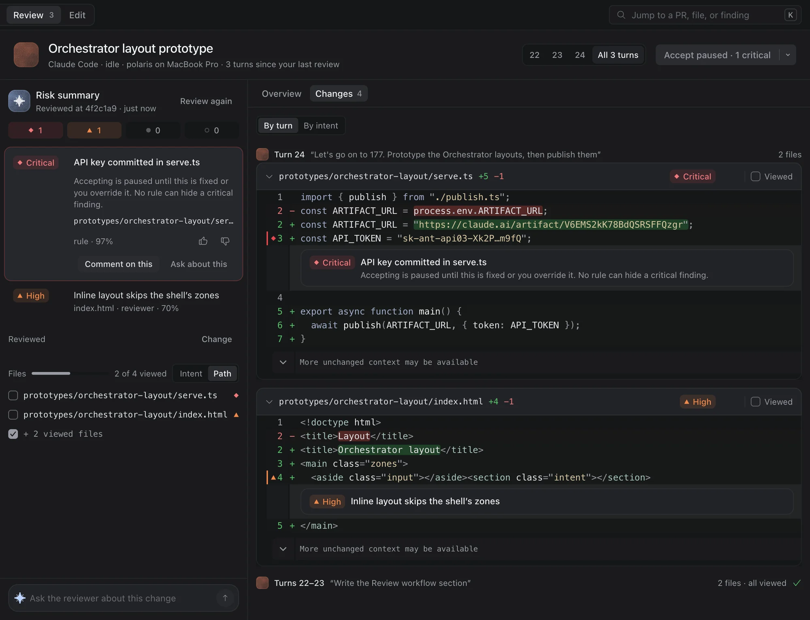
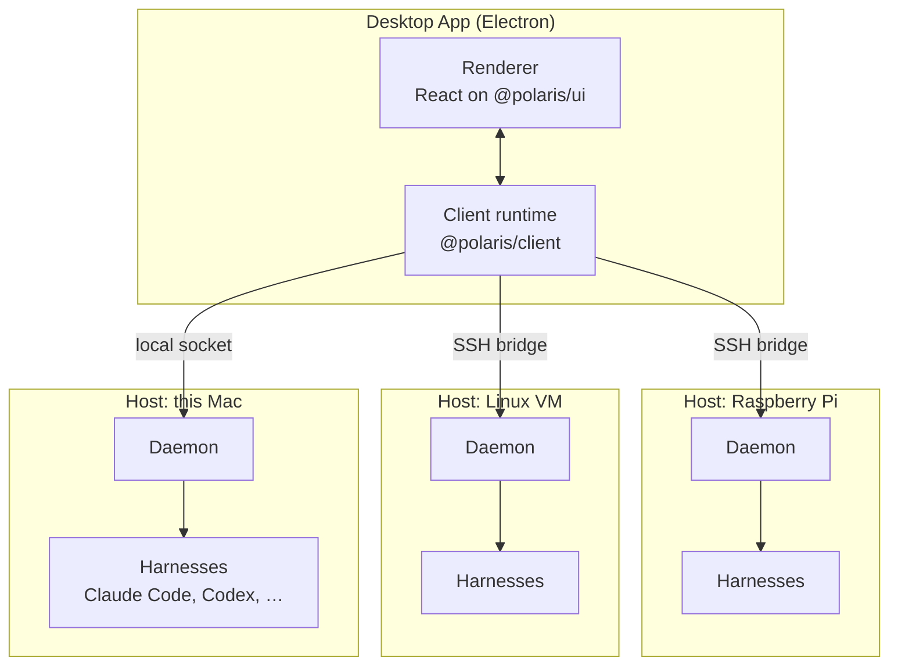

<a href="https://polaris.lux.dev">
  <picture>
    <source media="(prefers-color-scheme: light)" srcset="docs/assets/readme/hero-light.webp">
    
  </picture>
</a>

<p align="center">
  <a href="https://github.com/luxdotdev/polaris/actions/workflows/ci.yml"></a>
  <a href="LICENSE"></a>
  
</p>

<p align="center">
  <a href="https://polaris.lux.dev">Website</a>
  ·
  <a href="https://github.com/luxdotdev/polaris/releases">Download</a>
  ·
  <a href="docs/adr">Decisions</a>
  ·
  <a href="CONTEXT.md">Glossary</a>
  ·
  <a href="DESIGN.md">Design</a>
  ·
  <a href="CONTRIBUTING.md">Contributing</a>
</p>

> [!NOTE]
> Polaris is early and moving quickly. The Desktop App ships for macOS on Apple silicon. The Windows build is experimental and unsigned, and connects only to remote Hosts.

## About

Polaris is an IDE and agent orchestrator. It drives the coding agents you already use, such as Claude Code and Codex, rather than reimplementing one, and supervises their Agent Sessions across this Mac and any machine you can reach over SSH, all from one window.

It shows what every agent is doing, calls you only when one Needs You, and puts the riskiest changes first when you review. Then you read and edit the code yourself, in the same app.

Each Host runs a small Bun Daemon that owns its Agent Sessions, files, terminals and language tooling. Sessions outlive the Harness process and Daemon restarts, and the Desktop App picks up where it left off when a connection comes back.

## Features

- **Orchestrate.** Start, watch and steer Agent Sessions in [Claude Code, Codex, OpenCode, Gemini CLI and GitHub Copilot CLI](packages/protocol/src/harnesses.ts), side by side, across Hosts and Workspaces. Each session's Session State is visible at a glance; approvals and questions collect in one Needs You inbox, with notifications and a menu bar count. Polaris never installs a Harness or signs in for one ([ADR 0001](docs/adr/0001-polaris-never-touches-provider-credentials.md)).
- **Any Host.** The Mac you're on, a Linux VM, a Raspberry Pi: Polaris installs and upgrades its Daemon over your existing SSH config, after you approve its SHA-256. On Windows, WSL 2 distros are Hosts too.
- **Constellations.** A Lead session maps work into a graph of Tasks, starts an Attempt at each in its own Agent Session, and hears their Claims. You see what is blocked, in review or waiting on you.
- **Review.** Judge an open pull request or an Agent Session's Turns in a Review Checkout, away from your own working tree. A Risk Summary from rules, a secret scanner and a Reviewer of your choice ranks the Risk Findings by Severity, and you record a Verdict on each.
- **Editor.** Read and edit code on any Host with language servers for TypeScript, Python, Go, Rust, Java, PHP, Lua, SQL, Svelte and more; follow a Harness as it edits a file; ask for an inline change.
- **Tab completion.** Fill-in-the-middle completions from a model server you run yourself (llama-server, LM Studio, Ollama or any OpenAI-compatible endpoint).
- **Terminals.** Real terminals on every Host, and a Harness's own terminal UI when you want to take a session over (In Terminal) and hand it back.

<picture>
  <source media="(prefers-color-scheme: light)" srcset="docs/assets/readme/constellation-light.webp">
  
</picture>
<p align="center"><sub>A Lead and its Constellation</sub></p>

<picture>
  <source media="(prefers-color-scheme: light)" srcset="docs/assets/readme/review-light.webp">
  
</picture>
<p align="center"><sub>Review, guided by a Risk Summary</sub></p>

<sub>Screenshots show the Desktop App running on fixtures.</sub>

## Install

**Download.** Get the DMG for macOS (Apple silicon) from the [latest release](https://github.com/luxdotdev/polaris/releases) or [polaris.lux.dev](https://polaris.lux.dev). The Desktop App updates itself to each new Release and carries the Daemon builds it installs on your Hosts. Install at least one [Harness](packages/protocol/src/harnesses.ts) on the Hosts where you want agents to run.

**Build from source.** You need [Bun](https://bun.sh) 1.3.9 or later and git.

```sh
git clone https://github.com/luxdotdev/polaris.git
cd polaris
bun install
bun run --cwd apps/desktop dev
```

In dev the Desktop App connects to the Daemon at `~/.polaris/daemon.sock` if one answers; otherwise it starts its own from source, with a scripted Harness that spends no tokens ([ADR 0007](docs/adr/0007-the-desktop-dev-daemon-is-its-own.md)). Packaging and releases are in [`apps/desktop/README.md`](apps/desktop/README.md).

## How it works



- A **Host** is a machine where code lives and agents run. Its **Daemon** (`polaris`, a compiled Bun binary) runs as a user service and owns that Host's Agent Sessions, event store, git and Worktrees, files, terminals and language servers.
- A **Client** connects to many Daemons at once: the local one over a socket, remote ones through `ssh <host> polaris bridge`. Each connection has its own Connection State, and resumes from the last event it saw.
- Every change is an event in the Daemon's log; Session States are derived from it by a pure state machine, so recovery after a crash or restart never continues a Turn on its own ([ADR 0004](docs/adr/0004-restart-recovery-never-continues-a-turn.md)).
- The wire contract is [`packages/protocol`](packages/protocol), on Effect Schema and Effect RPC. The store, streams, recovery, approvals and resume are specified in Quint in [`packages/spec`](packages/spec) and checked against the real code by model-based tests.

The words used here are defined in [`CONTEXT.md`](CONTEXT.md); the decisions behind them are in [`docs/adr`](docs/adr).

## Repository layout

| Path | What |
|---|---|
| [`apps/daemon`](apps/daemon) | The Daemon: event store, Harness drivers, transport, files, git, terminals, language tooling. |
| [`apps/desktop`](apps/desktop) | The Electron Desktop App: Client runtime in the main process, a typed IPC bridge, a React renderer. |
| [`apps/site`](apps/site) | [polaris.lux.dev](https://polaris.lux.dev), with the download and update feed routes. |
| [`packages/protocol`](packages/protocol) | The wire contract every Client and the Daemon depend on. |
| [`packages/client`](packages/client) | Connections to many Daemons over SSH, Connection States, resume, install and upgrade. |
| [`packages/ui`](packages/ui) | The design system in code: DESIGN.md's tokens, components and a gallery. |
| [`packages/predict`](packages/predict) | The fill-in-the-middle predictor behind tab completion. |
| [`packages/spec`](packages/spec) | The Quint specification and its checks. |
| [`packages/bench`](packages/bench) | Benchmarks: the real Daemon under scripted load, with per-machine baselines. |
| [`packages/lint-config`](packages/lint-config) | Shared oxlint and oxfmt config and custom rules. |
| [`tooling`](tooling) | The lint ratchet, the quality runner and the git hooks. |
| [`design`](design) | Brand assets and the scripts that generate them. |

Product and design truth live in [`PRODUCT.md`](PRODUCT.md) and [`DESIGN.md`](DESIGN.md).

## Contributing

Issues and pull requests are welcome. Read [`CONTRIBUTING.md`](CONTRIBUTING.md) for setup, the git hooks, the lint ratchet, tests, the spec and the rules for borrowed code. Everyone taking part follows the [Code of Conduct](CODE_OF_CONDUCT.md).

## Security

Please don't open a public issue for a vulnerability. See [`SECURITY.md`](SECURITY.md) for how to report one privately.

## Licence

Polaris is licensed under the [Apache License 2.0](LICENSE), © 2026 lux.dev LLC. Some assets are under their own licences (the Nucleo icons and the Geist Pixel font); see [`NOTICE`](NOTICE). Code adapted from other projects is listed in [`ATTRIBUTION.md`](ATTRIBUTION.md), and dependencies in [`THIRD_PARTY_NOTICES.md`](THIRD_PARTY_NOTICES.md).
