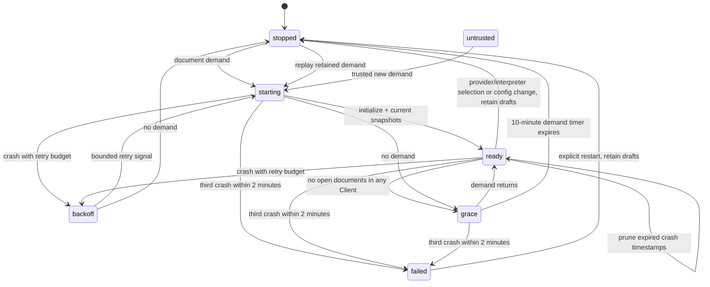

# Host language process lifecycle

`LanguageBroker.layer` requires the accepted D1 services and injected launch resolution.
It does not advertise capabilities or install tools. G2 binds authenticated Client
identity, authoritative checkout registry, prerequisite/version/artifact resolution,
connection loss, trust/config invalidation and event streams. Launch values remain
private. `requestRaw` is the generation/version-fenced formatter seam; feature
requests use P1 schemas. `prepareEdit` must snapshot/revalidate affected files
through the edit coordinator; absent that callback, server applyEdit fails closed.
A forwarded proposal still requires Client acceptance, followed by a generation-bound
server response. The broker never writes a draft or resource edit to disk.

`watchLog` exposes bounded server output separately from the context
events. Each process generation retains at most 2,000 lines and 512 KiB of encoded
line data in memory; lines truncate at 8 KiB. Subscribers get one atomic backlog and
then live lines, with 16 subscribers and a 256-event/2 MiB queue limit. A slow
subscriber fails `queue-full`. Unsubscribe or disconnect releases its queue;
process retirement clears the ring and ends subscriptions. Clients resubscribe
with the existing Replaced identity. No log text enters the EventStore or disk,
and observation adds no timers or demand. stderr retains its existing flood gate.

`format` implements the existing provider formatter port, validating exact synced
snapshot, document version and generation before dispatch and after the response.
It returns typed edits for Client undo; it never saves. Whole-document and range
formatting also use the generic feature port and negotiated provider capabilities.
Executable formatters remain outside this server port.

Disconnect/stop from every node enters stopped; revocation enters untrusted.
XState is a pure decider, not an actor with hidden timers. Timers are scoped to
last-document grace across Clients, requests and bounded retry signals. Contexts
are ephemeral;
there is no durable event-log copy of unsaved content. Restart/revocation/loss
retires the old generation and its pending requests before cleanup. Manual
restart and provider selection retain text and publish a Replaced fact so Clients
adopt the new generation and acknowledgment. Crash generations also retain drafts
and publish Replaced; connection loss clears
snapshots. No unknown edit outcome is retried. Two exponential retries (250 ms,
500 ms) precede Stopped(crash-budget) on the third crash within two minutes. The
machine's failed node prevents demand from bypassing that stop; manual restart
clears the timestamps. Closing during pending admission stops without spending
the crash budget. Old timestamps are pruned only on a crash, without polling.
Stopped facts include the final 4,096 characters of stderr for the authenticated owning Client.

One demand-scoped watcher group per TypeScript checkout reuses the existing tree
watcher and shared parent watches for TypeScript metadata. A 300 ms burst debounce
uses the machine's change event, preserving the crash budget, and restarts all
affected Client contexts with current unsaved text and queue sequence.
Idle expiry stops processes even while context interests remain;
watchers retain the context interests so a stopped context stays fresh.
Retained interests receive a Replaced stop fact and can reopen. Empty released
contexts are removed along with their watches. Reopening cancels grace across the
checkout/provider group.
The language subsystem adds no periodic work to an unused Daemon.

Retirement cancels the generation's stderr reader without waiting for its source
finalizer, so an inherited open pipe cannot hold broker cleanup indefinitely.
Transport close likewise cancels stdout without awaiting its source finalizer,
then waits for reader/write settlement and actual owned process stop. Close is
idempotent; its 10 s finalization deadline rejects instead of reporting success.
Failed or pending process stop does not release its process-budget reservation.
The broker keeps actual teardown settlement tracked after that deadline rejects.
Each broker close remains bounded while teardown is pending. Permanently rejected
teardown remains tracked and rejects repeated close; it cannot become clean success.
POSIX cleanup signals the owned process group; descendants that escape that group
are outside that termination guarantee. Windows cleanup remains untested.

Server logMessage/showMessage and stderr no longer emit placeholder context Log
events. Genuine configuration-watcher warnings retain that variant; private
server output remains in `languages.log.watch` only.

Python interpreter selection on the Host uses this same Restart transition for all
basedpyright contexts in the Workspace, with no Trust grant. Ruff stays running.
The private per-Workspace revision/path CAS is distinct from the event log; after
a Daemon restart, discovery reads the persisted selection. Replaced preserves
unsaved text and synchronization sequence exactly as other provider selections.
