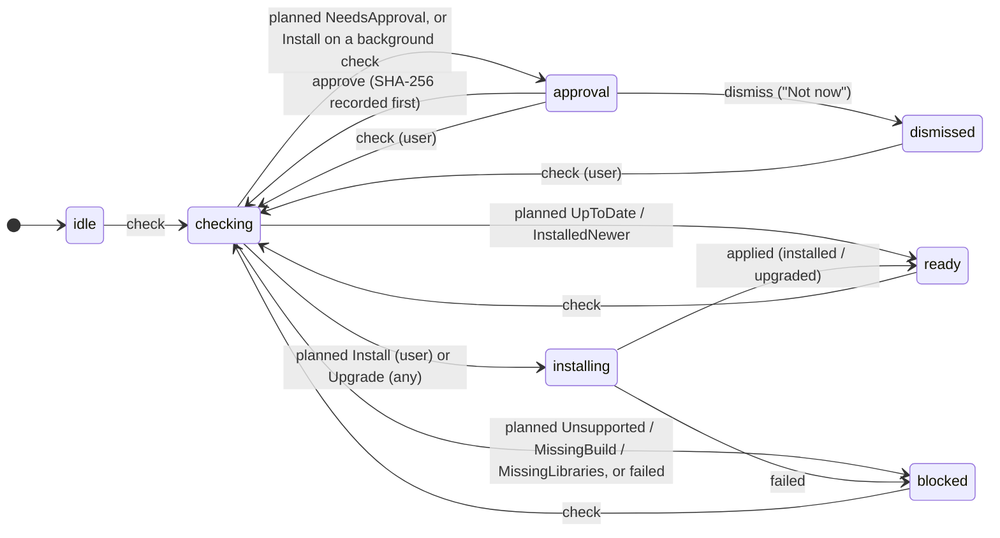

# Machines (main process)

The Hosts in Settings: adding and removing remote Hosts by `~/.ssh/config` alias, each one's install flow, the local Host switch, and the `machines` feed the renderer's Settings → Hosts page (`src/renderer/features/machines/`) shows. Decisions: ENG-179 (SSH, install approval), DESIGN.md "Settings · Hosts (S4)" and "Onboarding".

| File | What |
|---|---|
| `service.ts` | `Machines` (Context.Service): `add`, `update`, `remove`, `check`, `updateDaemon`, `setKeepDaemonsUpToDate`, `setDaemonUpdateOverride`, `approve`, `dismiss`, `startDaemon`, `setLocalEnabled`, `harnesses`, `openSsh` (the terminal fallback), and `views` (the feed). Runs the probes and uploads, and the background checks. |
| `installFlow.ts` | The install flow as an `xstate/fsm` machine; pure. |
| `views.ts`, `updateFacts.ts` | `MachineView`s from settings, Host list and install flows; `backgroundCheckKey`; the Daemon report's notes. Pure. |
| `remote.ts` | The side effects on a Host's `HostChannel`: probe and plan, apply (upload, SHA-256 check, `polaris install|upgrade`), restart the service. |
| `channels.ts` | Which channel a key names comes from `HostAccess` (`@polaris/client/access`; ssh, `wsl.exe` or a local shell, from the Host's `HostTarget`); this file is the card's copy per channel and the message when there is none (the app's own dev Daemon, a Windows Client's local Host, a terminal on this Mac). Decisions: docs/adr/0045-platform-services.md. |
| `sshConfig.ts` | The literal `Host` aliases in `~/.ssh/config`: `Include` followed (globs, `~`, relative to `~/.ssh`, 16 deep), wildcards and negations skipped, `Match` blocks ignored. |
| `approvals.ts` | `<userData>/approvals.json`: approved SHA-256 per alias. |
| `builds.ts` | Where the Daemon builds come from (below). |
| `wsl.ts` | WSL 2 distros as Hosts on Windows (experimental): the distro list for "Add a host" (WSL 1 distros marked unsupported; not-installed / no-distros states), the install copy for a distro, and the terminal command. `Machines` gets the distro list (`discoverWsl`) from `@polaris/client/wsl`; a `RemoteHostSetting` with `kind: "wsl"` names the distro in `alias` and its install flow runs the same probe, upload and `polaris install` through `wsl.exe --exec`. Decisions: docs/adr/0036-wsl-hosts.md. Unverified on real WSL; `wslService.test.ts` runs it through the fake `wsl.exe`. |
| `terminal.ts` | The terminal fallback for `ssh <alias>` when the local Host is off: a `.command` file in macOS Terminal, Windows Terminal or cmd, or a script in `$TERMINAL` or a common Linux emulator. Otherwise the renderer runs it, and a Harness's sign-in, in the shell's `HarnessTerminal` slot on a Daemon. |
| `fakeHost.testing.ts` | A fake remote Host for `service.test.ts` and the smoke test; not shipped. |

## The install flow

- **Only the user installs.** A check is `user` (added the Host, Install, Approve, Try again) or `background`. A background check that finds no Daemon asks for approval, even when this build's SHA-256 was approved before: the planner returns `NeedsApproval(background)`, and the machine turns even an `Install` plan on a background check into a question (tested from every state).
- **Upgrades need no new approval**, on any trigger; the outcome (`upgraded`, from → to) stays quiet: "Upgraded to …" in the machine bar for an hour or until opened, its hover card, and the Hosts row for a day. There is no success toast (DESIGN.md, Updates and daemon upgrades).
- **This Mac follows the same rule** when its local Host is the installed system Daemon (`LocalDaemon.installedHome`; never the app's own dev Daemon or a given socket): a connection to an older Daemon, or to any other version under a dev build (`upgradeDue`, D211), upgrades it with `polaris upgrade` (execve, sessions keep running), through the same planner, upload and SHA-256 check run in a local shell (the local `HostChannel`, which `HostAccess` builds only for an installed home). With nothing installed there, the socket transport reports `polaris-not-installed` and the app installs the build it carries, with no approval (`trusted`; docs/adr/0041-the-app-installs-this-macs-daemon.md), on the first background check or on Install. `check("local")` runs it on demand (the composer's "Upgrade daemon"); `startDaemon("local")` runs the installed `polaris install` in the local shell (or installs when nothing is), then waits for the socket (`localListening`) and fails with the Daemon's log when it never opens. `POLARIS_DESKTOP_LOCAL_HOME` marks a given socket's Daemon as installed in that home (tests: `scripts/oldDaemon.ts`).
- **Keep Daemons up to date** defaults on. `settings.json` stores the app-wide default and optional per-Host overrides (including this Mac); null in IPC restores inheritance. Enabling it checks already connected Hosts. Turning it off suppresses background upgrades, including protocol-mismatch recovery, but still offers the existing first-install approval. A background probe rechecks the policy before applying a plan.
- **Update now** (`machines.updateDaemon`) updates an installed Daemon even when automatic updates are off. It never performs a first install, including with an approved hash. Repeated checks during checking/installing are ignored by the install machine and cannot replace its upload fiber.
- **Facts and progress** travel on the `machines` feed as `MachineView.daemon`: installed and target-specific bundled versions, update availability, effective policy, checking → uploading (actual streamed bytes, throttled to 10 updates/s) → switching (after SHA-256 verification) → done or failed. The last result and epoch-ms time persist in `settings.json`; failures include the SSH failure kind or administrator command. The renderer consumes that result for the quiet captions, with one-shot expiry timers only after an Upgrade. No Daemon idle timer or polling was added.
- **Background checks** run once per occasion (`backgroundCheckKey`): entering Needs Attention for `polaris-not-installed` or `protocol-mismatch`, or a new connection to a Daemon older than the bundled build. Not every 2-minute retry. Build metadata refreshes on connection occasions and explicit checks, including when an earlier manifest was missing.
- "Not now" parks the Host (`dismissed`); background checks leave it parked.
- An ssh failure during the check (`SshError`) is problem `ssh`: the row shows the Connection State's own card (host key, auth) instead.
- Linux linger needing an admin (`linger: "needs-admin"` in the report) becomes the outcome's `adminCommand`, shown as a card with the exact `sudo loginctl enable-linger <user>`.

## Daemon builds

`locateBuilds` picks, in order:

1. `POLARIS_DESKTOP_DAEMON_DIST=<dir>` (tests, the smoke test).
2. **Packaged app:** `<Polaris.app>/Contents/Resources/daemon/` (`process.resourcesPath`), holding `manifest.json` and `<platform>/polaris` exactly as `scripts/build-daemon.ts` writes `apps/daemon/dist`. The packaging step (`bun run --cwd apps/desktop package`) runs `bun run --cwd apps/daemon build` for every platform and stages `apps/daemon/dist` there (`extraResource`). A dev package carries all five builds. A release (`--release`) carries only its own platform's files (darwin-arm64 on the Mac, none on Windows) and a manifest listing every platform with its Release archive; a Host that needs another platform downloads it, and if it can't, this app downloads it into `<userData>/daemon-builds/` and uploads it (`downloadBuild`, [ADR 0043](../../../../../docs/adr/0043-daemon-downloads.md)). The install card says which: "Downloading the build on <host>…" or "Downloading the build to this Mac, then copying it to <host>".
3. **Dev:** the repo's `apps/daemon/dist`. `scripts/dev.ts` builds every target before launch and refreshes them before restart when Daemon/Client/protocol sources change. `scripts/build.ts` also builds every target and copies them into the unpacked app's `Resources/daemon`. An explicit `POLARIS_DESKTOP_DAEMON_DIST` fixture bypasses preparation. A user check can recover missing targets by rebuilding all of them under one build lock; rebuilding only one target at a new version would discard other targets from the manifest. Background reconnects never compile or install a missing Daemon.

## Tests

`installFlow.test.ts` (the machine, with the real planner), `views.test.ts`, `sshConfig.test.ts` (Include, Match, wildcards, globs, depth), `approvals.test.ts`, and `service.test.ts`: `Machines` against a fake Host whose ssh commands run in a local `sh` with HOME at a temp dir (add → approve → install; a reconnect with no Daemon asks and never installs, even approved; a background upgrade; not now; remove forgets approvals; an ssh failure). `access.test.ts` runs `Machines` on `HostAccess.test`, nothing spawned: Start daemon and the terminal hand-off reach each Host through its own channel, and a Host with none is refused before anything runs (also on the Windows CI leg). `updateProgress.test.ts` verifies real streaming byte counts and failed-upload cleanup; `builds.test.ts` checks bundled-source precedence and all-target recovery. End to end: `scripts/daemonUpdatesSmoke.ts` exercises install approval, explicit Update, settings and byte progress over typed IPC; `scripts/smoke.ts` adds `fake-studio` through a stand-in `ssh` on PATH, approves the install into a temp home and waits for it to connect to a real Daemon.

## Windows OpenSSH

Windows Firewall can make OpenSSH report `ssh: connect to host … port 22: Permission denied`
before authentication begins (verified on Windows 11 ARM64). Both bridge and installer classify
that connect-time refusal as unreachable, so the Connection State keeps retrying. The distinct
`Permission denied (publickey,…)` authentication response still requires attention.

Windows Clients expose remote Hosts only. The composition root gives them `LocalHost.unsupported` (`../local/`), so persisted local-Host preferences and local socket overrides cannot start, connect, install or upgrade a native Windows Daemon, and `HostAccess` builds no local channel there either. The `machines` feed omits the local row; renderer layout and copy stay with WSHELL.

The bridge uses one long-lived SSH process per Host. Windows omits `ControlMaster`, `ControlPath` and `ControlPersist` and creates no control directory. RPC calls and subscriptions share that bridge; a reconnect replaces it. macOS and Linux retain Polaris' multiplexing.

All SSH entry points prefer `%SystemRoot%\System32\OpenSSH\ssh.exe` on Windows, then PATH. An optional top-level `sshBinary` in `settings.json` overrides the bridge, installer and interactive trust command (restart the Desktop App after editing). For example, `"sshBinary": "C:\\Program Files\\Git\\usr\\bin\\ssh.exe"` selects Git Bash's client. Alternative clients may use different agents, config locations and `known_hosts`; configure and trust the alias with the selected client. Polaris never writes keys or `known_hosts`. Alias discovery still reads the Desktop App user's `.ssh/config`.

Discovery follows backslash Include globs, drive and UNC roots, quoted spaces, `~\`, `%USERPROFILE%` and `${USERPROFILE}` (environment names are case-insensitive; missing variables skip the Include). Native OpenSSH configuration accepts `${USERPROFILE}`; discovery's `%USERPROFILE%` convenience does not rewrite the config passed to SSH. Use `${USERPROFILE}` or a literal path in configurations consumed by native OpenSSH. Trust handoff launches `wt.exe new-tab -- <ssh> -- <alias>`, falling back on ENOENT to `cmd.exe /k`; shell metacharacters are rejected before either launch. The cmd command line uses explicit nested quotes and `windowsVerbatimArguments` to preserve paths containing spaces ([Node process-spawning contract](https://nodejs.org/api/child_process.html#child_processspawncommand-args-options)).

Without multiplexing the SSH process counts are:

| Operation | SSH processes |
|---|---:|
| Connect / reconnect | 1 each |
| RPC / subscription on a connected Host | 0 additional |
| Probe (platform, libc, runtime prerequisites, installed version together) | 1 |
| Install / upgrade application, with N bundled files | N uploads + 1 apply + 1 cleanup |
| Probe plus install / upgrade | N + 3 |
| Approval after an earlier probe | 1 fresh probe before application |
| Start an installed Daemon | 1 |

Uploads retain one hash-checked transfer per file. The probe already batches remote checks in one call; background checks remain driven by Connection State occasions. No polling or extra bridge was introduced.

Diagnostic fixtures were checked against [PowerShell/openssh-portable at d0c65f24](https://github.com/PowerShell/openssh-portable/tree/d0c65f24b6eec32b7cae4ed08eca81e8c1df791c): [host-key verification and authentication](https://github.com/PowerShell/openssh-portable/blob/d0c65f24b6eec32b7cae4ed08eca81e8c1df791c/sshconnect2.c#L108), [authentication methods](https://github.com/PowerShell/openssh-portable/blob/d0c65f24b6eec32b7cae4ed08eca81e8c1df791c/sshconnect2.c#L552), [unknown host key](https://github.com/PowerShell/openssh-portable/blob/d0c65f24b6eec32b7cae4ed08eca81e8c1df791c/sshconnect.c#L1247), [changed host key](https://github.com/PowerShell/openssh-portable/blob/d0c65f24b6eec32b7cae4ed08eca81e8c1df791c/sshconnect.c#L1765), [bad options](https://github.com/PowerShell/openssh-portable/blob/d0c65f24b6eec32b7cae4ed08eca81e8c1df791c/readconf.c#L983) and [Windows config ACLs](https://github.com/PowerShell/openssh-portable/blob/d0c65f24b6eec32b7cae4ed08eca81e8c1df791c/readconf.c#L2660). Win32-OpenSSH [issue 1887](https://github.com/PowerShell/Win32-OpenSSH/issues/1887) supplies the ProxyJump diagnostic `No such host is known`; both bridge and install classification recognize it.
