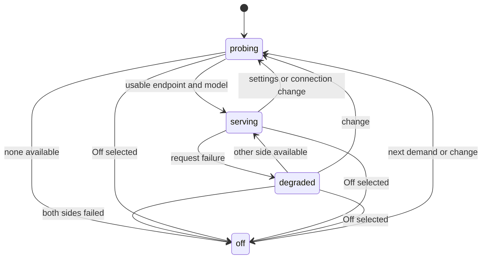

# Prediction placement

The Client main process owns one `PlacementController` per Workspace's Host.
`scorePlacement` ranks usable tier models by RAM tier, then a managed server
(one the serving Daemon runs itself, ADR 0049) over the user's own, then
measured rolling p50, then the Client for ties. Explicit choices restrict candidates to that side;
Auto falls back to the other side after endpoint failure, then Off. Pi-class
Hosts are excluded, including an explicit Host choice. A chosen model must be
advertised by the endpoint. An unknown model requires an explicit format.

`CapabilityProbe` is shared by the Client main process and Daemon. Default
localhost endpoint discovery and configured URLs are coalesced and cached for
five seconds on demand. No watcher or timer exists while idle. Each HTTP probe
has a 1.5s deadline and each machine command has a 1s deadline. CUDA/ROCm are
presence checks; discrete GPU memory is unknown, Apple unified memory is RAM.

The snapshot is transient derived state, never persisted. Probe generations
fence stale results; cancellation never degrades a side. No event-store commands
or recovery semantics change. Model server trees are reported separately from
Electron and Daemon memory and excluded from their 1 GB budget.

The Desktop App stores one global Client endpoint list in
`Settings.predictionClientEndpoints`; each Host retains `hostEndpoints`,
placement and model/format in `Settings.prediction[hostKey]`. IPC uses
`prediction.clientEndpoints.get/set` for the Client list and
`prediction.settings.get/set` for the Host preferences. Changing Client
endpoints invalidates all placement machines; changing Host preferences
invalidates only that Host. `MainPredictionPlacement.run` aborts the previous
request for that Workspace and passes a combined signal to the consumer.
Successful consumers feed the shared LatencyRecorder, including the Host
round trip; disposal calls `release`.

## Next-edit model selection

Placement accepts `mode: "complete" | "edit" | "auto"` (default `auto`;
v1 main-process callers explicitly request `complete`). Auto prefers eligible
next-edit candidates across both sides and falls back to FIM only when none exists. Edit mode never sends a FIM request.
Recognised ids match `/zeta[\W_]*2[._-]?1/i` or `/sweep.*next[\W_]*edit/i`;
these are also promptable entries in the existing Model list.

Each serving machine searches all its discovered endpoints and selects Sweep
Next-Edit by default on every machine (owner, 2026-10-15); Zeta 2.1 serves
only as a chosen model, or when it is the only next-edit model served. An explicit recognised model overrides that default and derives
its edit format even when an old FIM format preference is saved. RAM ranking,
side overrides, Pi exclusions, latency, cancellation and fallback use the same
placement machine. Older Daemons cannot be next-edit serving candidates.
